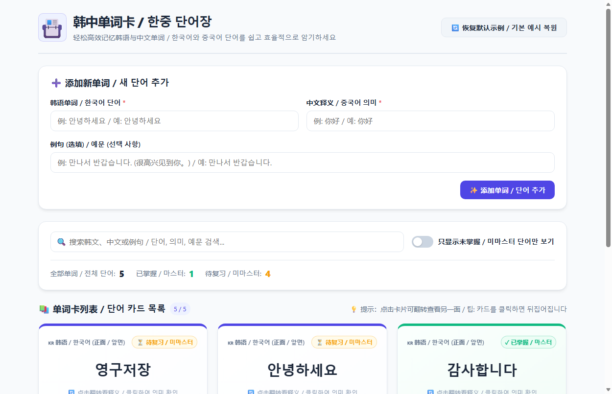

# 韩中单词卡 / 한중 단어장 (Korean-Chinese Flashcards)

> 一个轻量、优雅且高效的韩中双语单词记忆 Web 应用。  
> 가볍고 우아하며 효율적인 한중 단어 암기 웹 애플리케이션입니다.

---

## 📌 运行截图 / 실행 스크린샷

<!-- 运行截图预留位置 / 스크린샷 위치 -->


*(注：此处为截图预留展示位 / 참고: 스크린샷 표시를 위한 예약 위치입니다)*

---

## 📖 项目简介 / 프로젝트 소개

- **中文**：本应用旨在帮助语言学习者记忆韩语和中文单词。界面支持 3D 卡片翻转交互、智能搜索、已掌握状态切换及持久化本地存储，开箱即用。
- **한국어**: 본 애플리케이션은 한국어와 중국어 학습자의 단어 암기를 돕기 위해 개발되었습니다. 3D 카드 플립 상호작용, 실시간 검색, 마스터 상태 전환 및 로컬 저장소 영구 저장을 지원하며 설치 없이 바로 사용 가능합니다.

---

## ✨ 主要功能 / 주요 기능

1. **添加单词 / 단어 추가**
   - 支持录入韩语单词、中文释义和例句。
   - 한국어 단어, 중국어 의미 및 예문 입력 지원.
2. **3D 卡片翻转 / 3D 카드 뒤집기**
   - 点击单词卡可平滑翻转，正面查看韩语，背面查看中文及例句。
   - 카드를 클릭하면 부드럽게 뒤집히며, 앞면에서는 한국어, 뒷면에서는 중국어 및 예문을 확인할 수 있습니다.
3. **实时搜索 / 실시간 검색**
   - 支持按韩语、中文或例句关键词实时即时筛选。
   - 한국어, 중국어 또는 예문 키워드로 실시간 필터링 지원.
4. **掌握状态标记与筛选 / 마스터 상태 표시 및 필터**
   - 点击“标记已掌握 / 设为待复习”轻松切换掌握状态。
   - 勾选“只显示未掌握”，集中精力攻克未掌握生词。
   - "마스터 완료 / 미마스터로 변경" 버튼을 통해 학습 상태를 관리하고, "미마스터 단어만 보기" 필터로 복습에 집중할 수 있습니다.
5. **删除单词 / 단어 삭제**
   - 提供二次确认弹窗，安全便捷删除不再需要的单词卡。
   - 삭제 전 확인 모달을 제공하여 안전하고 간편하게 단어를 삭제할 수 있습니다.
6. **本地数据持久化 / 로컬 데이터 영구 저장**
   - 所有数据保存在浏览器的 `localStorage` 中，无需后端数据库，刷新页面数据不丢失。
   - 모든 데이터는 브라우저의 `localStorage`에 자동 저장되므로 서버 없이도 새로고침 후 데이터가 유지됩니다.
7. **中韩双语对照界面 / 한중 병기 인터페이스**
   - 所有按钮、标题、表单输入提示及弹窗提示均采用中文与韩文并列显示。
   - 모든 버튼, 제목, 입력창 안내 및 알림 메시지가 한국어와 중국어로 나란히 표시됩니다.
8. **语音发音辅助 / 음성 발음 지원 (TTS)**
   - 卡片配备中韩双语语音发音按钮，辅助听力与发音练习。
   - 카드에 한중 발음 듣기 버튼이 포함되어 있어 청취 및 발음 연습이 가능합니다.

---

## 🚀 运行方法 / 실행 방법

本项目为纯前端静态 Web 应用，无需安装任何额外依赖或后端环境。

### 方法一：直接双击运行 (추천 / 推荐)
- 直接在文件管理器中找到 `index.html`，双击即可在任意现代浏览器（Chrome、Edge、Safari、Firefox 等）中打开并运行。
- 파일 탐색기에서 `index.html`을 더블클릭하면 모든 모던 브라우저에서 즉시 실행됩니다.

### 方法二：通过本地 HTTP 服务启动 / 로컬 HTTP 서버 실행
如果您希望通过本地服务访问：
```bash
# 使用 Python 启动本地服务 / Python으로 로컬 서버 실행
python -m http.server 8080

# 访问地址 / 접속 주소:
# http://localhost:8080
```

---

## 📂 项目文件结构 / 프로젝트 파일 구조

```text
korean-chinese-flashcards/
├── index.html        # 主页面骨架与双语结构 / 메인 HTML 구조
├── style.css         # 样式表与 3D 翻转动画 / 스타일 및 3D 플립 애니메이션
├── app.js            # 核心业务逻辑与数据存储 / 비즈니스 로직 및 로컬 스토리지
└── README.md         # 中韩双语使用说明 / 한중 이중언어 설명서
```

---

## 💡 使用步骤说明 / 사용 방법

1. **打开网页 / 웹페이지 열기**: 运行 `index.html`。
2. **添加单词 / 단어 추가**: 在表单中输入韩语（例：`안녕하세요`）和中文（例：`你好`），可选输入例句，点击 **添加单词 / 단어 추가**。
3. **记忆翻转 / 뒤집기**: 点击卡片任意非按钮区域即可翻转卡片。
4. **标记掌握 / 마스터 표시**: 点击卡片底部的 **⭐ 标记已掌握 / 마스터 완료** 按钮。
5. **筛选复习 / 복습 필터**: 勾选顶部的 **只显示未掌握 / 미마스터 단어만 보기** 集中背诵未掌握词汇。
